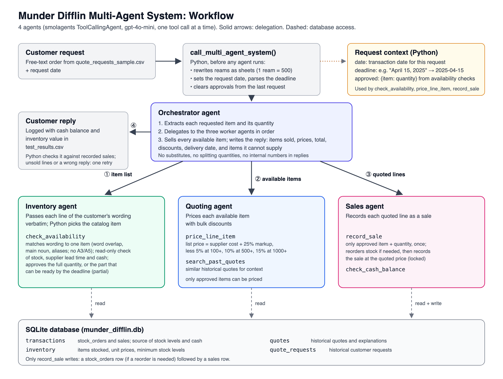

# Munder Difflin Multi-Agent System: Project Report

## 1. Summary

This project builds a multi-agent system that handles free-text customer orders for the fictional Munder Difflin Paper Company. For each request, the system:

1. matches the customer's wording to catalog items,
2. checks how much of each item can be ready by the deadline, from stock or a supplier reorder,
3. quotes prices with bulk discounts,
4. records the sales, and
5. replies to the customer.

The system uses four agents, under the limit of five, built with `smolagents` on `gpt-4o-mini`. A full run over the 20 sample requests produced at least one sale in 19 requests, including 6 lines filled only in part. None of the 39 sales was mispriced or sold below cost. Total assets rose from $50,000.00 to $51,045.98.

The main design lesson was this: **let the LLM decide what to do, and let Python do every calculation, match and database write.** Most bugs found during testing came from the LLM choosing dates, quantities, prices or catalog items. Each was fixed by moving that decision into deterministic code.

For the full tool reference and the reasoning behind each design decision, see [`design_notes.txt`](design_notes.txt).

## 2. Architecture



| Agent | Tools | Role |
|---|---|---|
| **Orchestrator** | delegates to the three agents below | Extracts the requested items, delegates in order, sells everything available, and writes the customer reply. |
| **Inventory agent** | `check_availability` | Passes each line of the customer's wording to the tool, which matches it to one catalog item and checks stock, supplier lead time and cash. If only part of the quantity can be ready by the deadline, and at least half, it reports how much. Read-only. |
| **Quoting agent** | `price_line_item`, `search_past_quotes` | Prices approved items: the supplier cost plus a 25% markup, less 5%, 10% or 15% bulk discounts. |
| **Sales agent** | `record_sale`, `check_cash_balance` | Records each approved line. Places a supplier reorder first if needed. |

Python handles several things before and around the agents:

- **Before the agents run:** `call_multi_agent_system()` converts reams to sheets, sets the request date and parses the delivery deadline from the request text.
- **Approvals:** during the request it tracks which item and quantity `check_availability` approved for each line.
- **The guard:** only approved items can be quoted or sold, and each approval can be used only once.
- **Concurrency:** all tools run one at a time, and sale writes are locked.
- **After the agents finish:** if any approved line was not sold, the orchestrator is sent back once to sell it and rewrite the reply. Python then checks the reply against the recorded sales: the correct total, the requested quantity for partial lines, no request to confirm after a sale, and no internal details. If it fails, the orchestrator is asked to rewrite it, up to twice, with the full list of what the reply must contain.

## 3. Evaluation of test results

Results are in [`test_results.csv`](test_results.csv), from a full run of `quote_requests_sample.csv`.

### Headline results

| Metric | Result |
|---|---|
| Requests processed without error | 20 / 20 |
| Requests with at least one sale | 19 / 20 |
| Requested lines checked | 60 |
| Lines filled in full | 33 |
| Lines filled in part (at least 50% ready by the deadline) | 6 |
| Lines declined because less than 50% could be ready by the deadline | 5 |
| Lines declined because nothing could be ready by the deadline | 5 |
| Lines declined because the item is not carried | 11 (mostly A3/A5 paper; also balloons, cardboard, tickets) |
| Approved lines left unsold | 0 |
| Sales priced exactly at cost × 1.25 less the bulk discount | 39 / 39 |
| Sales below cost | 0 |
| Stock bought without a matching sale | 0 |
| Items with negative stock | 0 |
| Replies revealing stock levels, costs, markup or cash | 0 |
| Database integrity check | passed |
| Revenue / restock spending | $15,381.23 / $13,734.80 |
| Cash / inventory / total assets | $46,706.13 / $4,339.85 / $51,045.98 (started at $50,000.00) |

### Per-request outcomes

"N of M" marks a line filled in part: N units sold of the M requested.

| # | Date | Sold | Total | Not supplied |
|---|---|---|---|---|
| 1 | 04-01 | Glossy paper 200, Cardstock 100, Colored paper 100 | $77.19 | — |
| 2 | 04-03 | Poster paper 500, Party streamers 300 | $158.43 | balloons (not carried) |
| 3 | 04-04 | A4 paper 10,000, Standard copy paper 250,000 (500 reams) | $11,156.25 | A3 paper (not carried) |
| 4 | 04-05 | Cardstock 500, A4 paper 250 | $99.22 | — |
| 5 | 04-05 | Colored paper 500, Cardstock 300, Washi tape 200 | $157.19 | — |
| 6 | 04-06 | Construction paper 500, Standard copy paper 300, Cardstock 200 | $89.25 | — |
| 7 | 04-07 | Glossy paper 500, Large poster paper 300, Cardstock 200 | $504.37 | matte A3 paper (not carried) |
| 8 | 04-07 | Glossy paper 500, Matte paper 1,000, Recycled paper 3,000 | $558.75 | A5 colored paper (not carried) |
| 9 | 04-07 | A4 paper 135 of 200 | $8.02 | Envelopes (deadline); A3 glossy paper (not carried) |
| 10 | 04-08 | Glossy paper 500, Cardstock 300 | $165.94 | — |
| 11 | 04-08 | Matte paper 300 | $64.12 | A3 glossy paper (not carried) |
| 12 | 04-08 | Cardstock 200, Standard copy paper 500, Paper napkins 100 | $60.50 | — |
| 13 | 04-08 | Cardstock 148 of 200 | $26.36 | A4 paper (deadline) |
| 14 | 04-09 | Poster paper 1,000 of 2,000, Cardstock 500 | $350.00 | A4 paper (under 50% by deadline) |
| 15 | 04-12 | — | — | A4 paper (deadline); A3 colored paper (assorted colors), cardboard for signage (not carried) |
| 16 | 04-13 | Large poster paper 100, Construction paper 100 of 200 | $127.06 | A4 paper (deadline) |
| 17 | 04-14 | Paper plates 500 | $56.25 | Paper napkins (under 50% by deadline); A4 paper, Paper cups (deadline); A3 colored paper (assorted colors) (not carried) |
| 18 | 04-14 | Colored paper 188 of 200 | $22.32 | Cardstock, Standard copy paper (under 50% by deadline) |
| 19 | 04-15 | Glossy paper 1,000 of 2,000, Cardstock 1,000 | $371.88 | A3 matte paper (not carried) |
| 20 | 04-17 | Flyers 5,000, Poster paper 2,000 | $1,328.13 | tickets (not carried) |

### Strengths

- **Prices and the books are correct by construction.** Prices come from one function shared by quoting and sales. Dates come from Python. Stock is bought only inside `record_sale`, for items actually sold. Every sale matched the expected price, and no stock order lacks a matching sale.
- **Deadlines are respected, and as much as possible is still sold.** When the full quantity can't be ready in time, the system sells what can: current stock plus the largest supplier order that arrives by the deadline. For example, request 14 got 1,000 of 2,000 sheets of poster paper by April 13. A partial line is only sold if at least half the request can be ready, so a customer isn't sent, say, 135 of 10,000 sheets.
- **Catalog matching is consistent.** Everyday wording maps to the right item, for example "colorful cardstock" to Cardstock, "colorful construction paper" to Construction paper, and "poster boards (24" x 36")" to Large poster paper. Paper sizes the catalog doesn't stock, such as A3 and A5, are declined, not swapped for A4.
- **Large orders work.** Request 3's 500 reams were converted to 250,000 sheets, restocked in time, and sold at a profit: $10,625.00 in revenue against a $10,004.00 restock cost.
- **Replies are customer-safe.** They list items, prices, discounts and delivery dates, and never mention stock levels, costs, the markup or cash.

### Weaknesses

- **Many lines are only partly filled (12 of 60).** Supplier lead time is fixed by `get_supplier_delivery_date`, and only about 40% of catalog items start in stock, so later requests with April 15 deadlines can only be partly met.
- **LLM behavior varies from run to run.** In the previous run, the orchestrator declined all of request 18 because two of its lines were under the 50% minimum, leaving an approved line unsold. Request 16's reply asked the customer whether to proceed after the sale was already recorded, and its sales agent tried to record both lines twice; the approval guard blocked the duplicates. Neither happened in this run. A Python follow-up now catches unsold approved lines, but it wasn't needed in this run, so it has only been tested offline. Reply wording has no such check.
- **Matching is a heuristic.** It uses word overlap, a main-noun bonus and a few aliases, tuned on the sample wording. Brand names or unusual wording would need new aliases, and attributes like "recycled" or "white" are ignored.
- **Some behavior still relies on the LLM following instructions,** such as copying the customer's wording verbatim and always selling available items. The tool guards prevent wrong sales, but they can't force a sale the agent skips.

## 4. What testing changed

The system went through about a dozen test runs. Each fix below came from a specific failure:

| Failure observed | Fix |
|---|---|
| LLM invented dates (e.g. 2023-11-24), causing false "insufficient funds" refusals and negative stock | Request date and deadline set in Python; tools take no dates |
| Sales recorded at undiscounted prices | One pricing function for quotes and sales |
| Checking availability bought stock for items never sold | Read-only `check_availability`; buying only in `record_sale` |
| Orchestrator sold 10 substitute products (~$36,000) for one order | Sales limited to items approved for that request |
| 500 reams quoted as 500 sheets | Reams converted to sheets in Python |
| Parallel tool calls corrupted the SQLite database | One tool call at a time, and a lock around sale writes |
| Discounted bulk sales lost money | 25% markup over supplier cost |
| Agents picked different catalog items for the same line | Matching done once in Python; quotes and sales resolve to the approved item |
| "250,000 sheets of cardboard" matched "250 gsm cardstock" via the quantity's digits | Leading quantities stripped before matching (spec numbers like "250 gsm" kept) |
| Lines that couldn't be fully ready by the deadline were declined outright | Partial fulfillment: sell what can be ready in time |
| Partial sales as small as 135 of 10,000 sheets | Partial lines need at least 50% of the requested quantity |
| Orchestrator declined a whole order, leaving an approved line unsold | Python checks for unsold approvals and sends the orchestrator back once |
| Replies asked to proceed after a sale, or presented partial lines as complete | Python checks the reply against recorded sales and asks for one rewrite |

## 5. Suggested improvements

1. **Backorders.** Partial fulfillment ships what can arrive by the deadline and declines the rest. Offering the remainder as a backorder with its later date would suit customers whose deadline is flexible.
2. **Smarter matching.** Use embeddings, or an LLM ranking step limited to the catalog, to handle unfamiliar wording and attributes like "recycled".
3. **Better restocking.** Restock popular items ahead of demand instead of only when an order needs them, so more April 15 deadlines can be met.
4. **Structured handoffs.** Have agents pass JSON item lists, not free text, to remove the remaining LLM-dependent steps.

## 6. How to run

```bash
python3.11 -m venv .venv && source .venv/bin/activate
pip install -r requirements.txt
echo "UDACITY_OPENAI_API_KEY=<your key>" > .env
python project_starter.py
```

The run takes about 15–25 minutes. It writes `test_results.csv` and prints the final financial report.
